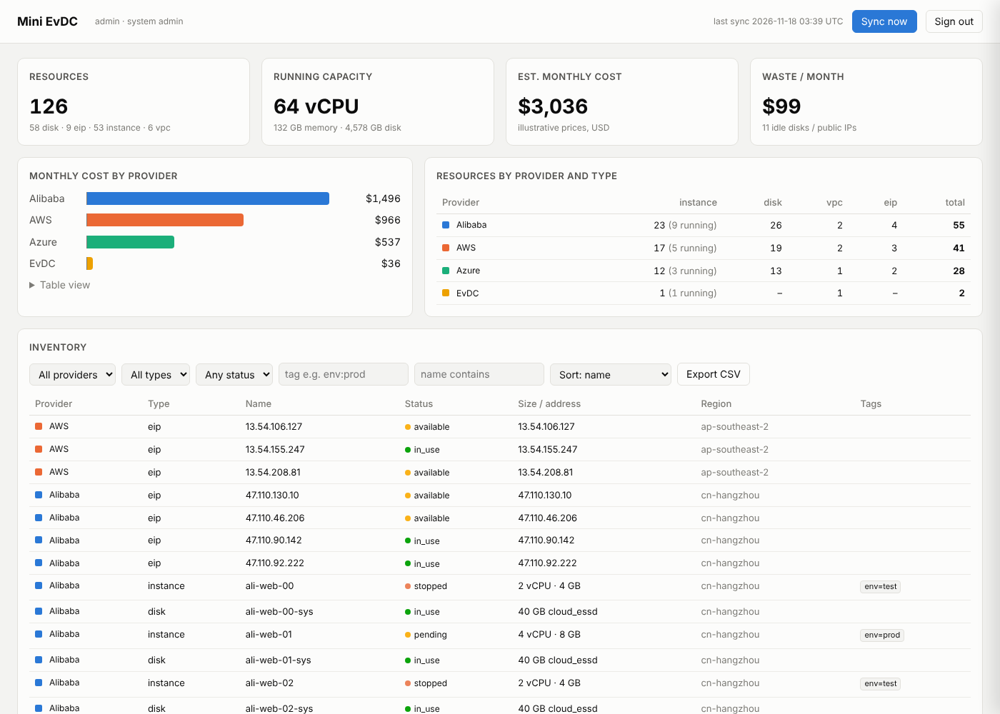

# Mini EvDC


A simplified, runnable re-creation of **EvDC (Enterprise Virtual Data Center)**, the enterprise cloud
platform I worked on at VNET, together with the **multi-cloud integration service** that connected
Alibaba Cloud, AWS and Azure to it.

- **Platform:** multi-tenant orgs, VDCs with quotas, networks with IP allocation, VMs, templates,
  snapshots, an edge gateway (firewall + NAT) and a distributed firewall driven by security tags.
- **Multi-cloud integration:** instances, disks, VPCs and public IPs from three clouds mapped into one
  resource model, kept in sync, queryable live, and manageable (start / stop / reboot) through one API.
- **Cost & governance:** per-resource monthly cost estimates and a waste report, JSON governance
  policies with dry-run (find unattached disks, idle public IPs, untagged or test instances, then mark
  or stop them), a resource relationship graph, flexible queries with CSV export, Prometheus metrics.
- **Engineering:** API keys with role-based access, SQLite persistence, change history, timeouts and
  retries, structured JSON logs, a web dashboard, an API audit trail, an OpenAPI document, 120 tests, lint + CI on Python 3.10 – 3.13.
- **Production readiness:** liveness / readiness probes, graceful shutdown, a hardened container,
  docker compose with Prometheus alerts and a Grafana dashboard, Kubernetes manifests (Pod Security
  "restricted", NetworkPolicy, staging / production overlays), and a supply chain with CodeQL,
  bandit, pip-audit, Trivy, Dependabot and releases that ship an SBOM and build provenance.

Pure Python standard library: no dependencies and no cloud account needed (realistic fake clouds are built in).

```
python -m evdc demo                                        # end-to-end walkthrough in the terminal
python -m unittest discover -s tests -p "test*.py" -t .    # 120 tests
ruff check evdc tests                                      # lint (same as CI)
python -m evdc serve --config accounts.example.json --sync-interval 300   # API + dashboard on :8080
```

Then open http://127.0.0.1:8080 and sign in with the admin key printed on first start
(or the one you set in `EVDC_ADMIN_KEY`). To use real cloud accounts instead of the built-in
fakes, see [docs/AWS.md](docs/AWS.md), [docs/ALIYUN.md](docs/ALIYUN.md) and [docs/AZURE.md](docs/AZURE.md).
The machine-readable API description is served at `GET /openapi.json` (import it into Postman or
Swagger UI).

## Dashboard

A single page served by the API itself (`GET /`), no build step and no external assets:

- headline numbers: resources, running capacity, estimated monthly cost, waste
- monthly cost by provider, resources by provider and type
- inventory with filters (provider, type, status, tag, name), sorting, paging and CSV export
- a detail drawer per resource: fields, relations, change history and, for system admins,
  refresh / start / stop / reboot
- governance policies with **Preview** (dry run) and **Apply**, the waste list and sync history
- follows the system light / dark setting; the API key is kept only in the browser



## Architecture

```
         ┌──────────────────────────── REST API (api.py) ────────────────────────────┐
         │  API key ─► AuthService (system_admin / org_admin / viewer, org scoping)    │
         └───────────────┬───────────────────────────────────────┬─────────────────────┘
                         │                                       │
   ┌──────── Platform core (core.py) ─────────┐    ┌── Multi-cloud ───────────────────────────┐
   │ Org ─< VDC (quota) ─< Network (IPAM)      │    │ SyncService  parallel, upsert by uid,    │
   │  │             └─< VM (power, snapshot,   │    │              delete only after a full    │
   │  │                    security tags)      │    │              successful listing          │
   │  └─< Template (catalog)                   │    │ SyncScheduler  every N s, no overlap     │
   │ VDC ─ Edge: firewall (default deny), NAT  │    │ ResourceManager refresh / start / stop / │
   │     └ Distributed FW: east-west, by tag   │    │                 reboot any instance      │
   │ Task log; state saved after every change  │    └───────────────┬──────────────────────────┘
   └───────────────────────────────────────────┘                    │ ProviderAdapter interface
                         │                     ┌────────────────────┼───────────────────┐
                 EvdcLocalAdapter        AliyunAdapter         AwsAdapter          AzureAdapter
                         │               page no. + total      NextToken           nextLink + OAuth
                         ▼                     ▼                    ▼                   ▼
                    CloudResource (instance | disk | vpc | eip) ─────────► SQLite store (store.py)
                                                                           inventory · change history
                                                                           sync runs · platform state · users
```

Cross-cutting: `retry.py` (per-call timeout, exponential backoff with full jitter, retry only on
throttling / 5xx / timeout) and `logs.py` (JSON-lines logging with provider, account, operation and
attempt on every line).

## Feature list

### Multi-cloud integration service

| Feature | Details |
|---|---|
| **Unified resource model** | `CloudResource`: provider, account, region, native_id, type, name, status, vCPU, memory, IPs, size, tags, attributes. `uid = provider:account:native_id` |
| **Resource types** | `instance`, `disk`, `vpc`, `eip` on every provider (EvDC itself exposes its VMs and networks) |
| **Provider adapters** | One class per cloud, registered with `@register("aws")`. Adding a provider = one new file |
| **Authentication** | Aliyun AK/SK, AWS access keys, Azure OAuth client-credentials token with proactive refresh and one re-auth on expiry. Secrets come from `env:VAR` in config |
| **Pagination** | Page number + total count (Aliyun), continuation token (AWS), next-link URL (Azure), unpaged (AWS addresses) |
| **Timeout & retry** | `RetryPolicy(max_attempts, base_delay, max_delay, timeout)`; auth errors are not retried blindly |
| **Synchronisation** | Parallel per account; one failing provider does not stop the others; a sync that fails half-way never marks anything deleted; overlapping runs refused |
| **Scheduled sync** | `--sync-interval 300` runs a background sync every 5 minutes |
| **Live status query** | `POST /resources/refresh {uid}` asks the provider for one instance now (Aliyun `DescribeInstances(InstanceIds)`, EC2 `describe_instances(InstanceIds)`, Azure `GET vm?$expand=instanceView`) |
| **Unified management** | `start` / `stop` / `reboot` any instance by uid. Already-running is a no-op; invalid transitions are refused before calling the cloud; the provider's own refusal is surfaced as 409 |
| **Change history** | Every create, field change (with old → new values), deletion and action is recorded per resource |
| **Inventory summary** | Totals by provider, type and status; running vCPU / memory; total disk |

### Cost, governance and observability

| Feature | Details |
|---|---|
| **Cost estimate** | `GET /costs` – monthly estimate per resource, totals by provider and type, top spenders. Instances are billed only while running; disks always; public IPs at a flat fee. Prices live in `pricing.py` and are illustrative – swap in the AWS Price List API, Aliyun BSS or the Azure Retail Prices API for real numbers |
| **Waste report** | Unattached disks and unattached public IPs, with what they cost per month |
| **Governance policies** | JSON policies: `resource` + `filters` (`eq ne in not_in gt gte lt lte contains regex present absent` on any field, `tag:<k>`, `attributes.<k>`, `monthly_cost`, `marked`) + `actions` (`report`, `mark`, `unmark`, `stop`). **Dry run by default**; anyone may preview, only a system admin may act. Four built-in policies: `unattached-disks`, `idle-public-ips`, `untagged-instances`, `stop-test-instances` |
| **Mark, then act** | Like Cloud Custodian's mark-for-op: a first policy marks resources (e.g. `delete-in-30d`), a later one selects `marked` resources. Marks are recorded in the change history |
| **Query** | `GET /resources` filters by provider, account, region, type, status, `tag=env` / `tag=env:prod`, name substring; `sort=-vcpu` etc.; `limit` / `offset` with an `X-Total-Count` header. `GET /resources.csv` exports the same query |
| **Resource graph** | `GET /resources/relations?uid=` – an instance's disks and public IPs, or the instance a disk / IP belongs to. `GET /resources/orphans` – disks and IPs still pointing at instances that are gone |
| **Prometheus metrics** | `GET /metrics` – resource counts by provider / account / type / status, estimated monthly cost, last sync success and time per account, platform object counts |

### Platform core (EvDC rules)

| Feature | Details |
|---|---|
| **Tenancy** | Org → VDC (region, quota) → networks, VMs; templates per org |
| **Quotas** | vCPU, memory, storage (snapshots count). Quota can be raised or lowered, never below current usage |
| **Networks** | Routed or isolated, IPv4 /29 or larger, no overlaps inside a VDC, gateway = first host, IPs allocated and released automatically |
| **VMs** | Name rules from the EvDC user guide, size limits, power state machine (power_on / power_off / shutdown_guest / reset / suspend / discard_suspend), resize only when off, disks grow but never shrink |
| **Catalog** | Create templates, deploy VMs from them, capture a powered-off VM as a new template |
| **Snapshots** | One per VM (as in vCloud Director), revert, remove |
| **Edge gateway** | North-south firewall, first match wins, default deny; DNAT / SNAT. Inbound traffic needs **both** a DNAT rule and an allow rule |
| **Distributed firewall** | East-west rules by CIDR or `tag:<security tag>`, default allow (switchable to deny). Changing a VM's role = changing its tag, no rule edits |
| **Traffic checks** | `check-inbound` and `check-east-west` explain which rule delivered or dropped a packet |
| **Persistence** | The whole platform is saved to SQLite after every successful change and reloaded on start |
| **Task log** | Every change is a task with status, error detail and timestamps |

### Access control

| Role | Can do |
|---|---|
| `system_admin` | Everything: orgs, VDCs and quotas, multi-cloud sync and actions, task log, any user |
| `org_admin` | Full control inside its own org (networks, VMs, templates, rules, users of that org); read multi-cloud inventory |
| `viewer` | Read-only inside its own org |

Every write and every refused request (401 / 403) is written to an **audit trail** with user, role,
method, path, status and client address; system admins read it at `GET /audit`.
Keys are random tokens shown once; only the SHA-256 hash is stored. Send them as
`Authorization: Bearer <key>` or `X-API-Key: <key>`. The first `serve` creates a system admin
(key from `EVDC_ADMIN_KEY`, or printed once). More users: `POST /users` or
`python -m evdc create-user NAME --role org_admin --org ORG_ID`.

### How each cloud's data is mapped

| | Alibaba Cloud | AWS | Azure |
|---|---|---|---|
| instances | `DescribeInstances` → `Instances.Instance[]`, `Status: "Running"`, `Memory` in MB | `describe_instances` → `Reservations[].Instances[]`, `State.Name`; CPU/memory via `describe_instance_types` (cached) | `virtualMachines` → `value[]`, power in `instanceView.statuses`, size via VM sizes list (cached) |
| disks | `DescribeDisks`, `Status: In_use / Available`, `Size` GB | `describe_volumes`, `State: in-use / available`, `Attachments[]` | `disks`, `diskState: Attached / Unattached`, `managedBy` |
| VPCs | `DescribeVpcs`, `CidrBlock` | `describe_vpcs`, name from tag `Name` | `virtualNetworks`, `addressSpace.addressPrefixes` |
| public IPs | `DescribeEipAddresses`, `InstanceId` | `describe_addresses` (not paginated), `InstanceId` | `publicIPAddresses`, `ipConfiguration.id` |
| paging | `PageNumber` + `TotalCount` | `NextToken` | `nextLink` |
| start / stop / reboot | `StartInstance` / `StopInstance` / `RebootInstance` | `start_instances` / `stop_instances` / `reboot_instances` | `start` / `deallocate` / `restart` |

## REST API

Full route list with access rules is in the docstring of [`evdc/api.py`](evdc/api.py). A quick tour:

```bash
export K="Authorization: Bearer $EVDC_ADMIN_KEY"
curl -H "$K" -X POST localhost:8080/orgs -d '{"name": "acme"}'
curl -H "$K" -X POST localhost:8080/orgs/<org>/vdcs -d '{"name": "prod", "region": "huabei1",
     "quota": {"vcpu": 16, "memory_gb": 64, "storage_gb": 500}}'
curl -H "$K" -X POST localhost:8080/users -d '{"name": "acme-admin", "role": "org_admin", "org_id": "<org>"}'
curl -H "$K" -X POST localhost:8080/vdcs/<vdc>/networks -d '{"name": "app", "cidr": "192.168.10.0/24"}'
curl -H "$K" -X POST localhost:8080/vdcs/<vdc>/vms -d '{"name": "web-01", "vcpu": 2, "memory_gb": 4,
     "disk_gb": 40, "network_id": "<net>", "tags": ["web"], "power_on": true}'
curl -H "$K" -X POST localhost:8080/vdcs/<vdc>/dfw -d '{"name": "web-db", "source": "tag:web",
     "destination": "tag:db", "port": 5432, "action": "allow"}'

curl -H "$K" -X POST localhost:8080/sync
curl -H "$K" "localhost:8080/resources?provider=aws&type=disk&status=available"   # unattached disks
curl -H "$K" localhost:8080/resources/summary
curl -H "$K" -X POST localhost:8080/resources/start -d '{"uid": "aws:aws-syd:i-00000000000000001"}'
curl -H "$K" "localhost:8080/resources/history?uid=aws:aws-syd:i-00000000000000001"

curl -H "$K" "localhost:8080/resources?type=instance&tag=env:prod&sort=-vcpu&limit=5"
curl -H "$K" "localhost:8080/resources.csv?provider=aliyun" -o inventory.csv
curl -H "$K" "localhost:8080/resources/relations?uid=aliyun:ali-prod:i-bp1000000000000000"
curl -H "$K" localhost:8080/costs
curl -H "$K" -X POST localhost:8080/policies/run -d '{"name": "unattached-disks"}'                    # preview
curl -H "$K" -X POST localhost:8080/policies/run -d '{"name": "unattached-disks", "dry_run": false}'  # act
curl -H "$K" -X POST localhost:8080/policies/run -d '{"policy": {"name": "big-vms", "resource": "instance",
     "filters": [{"key": "vcpu", "op": "gte", "value": 8}, {"key": "status", "op": "eq", "value": "running"}]}}'
curl localhost:8080/metrics                                                                      # Prometheus
```

Errors: 400 bad input · 401 no/invalid key · 403 role or org not allowed · 404 not found ·
405 wrong method · 409 quota / wrong state / sync running · 501 unsupported action ·
502 provider still failing after retries.

## Production deployment

| Option | What you get | Guide |
|---|---|---|
| docker compose | app + Prometheus (alert rules) + Grafana (dashboard provisioned), hardened container | [deploy/README.md](deploy/README.md) |
| Kubernetes (Kustomize) | probes, graceful rollout, Pod Security "restricted", NetworkPolicy, ConfigMap / Secret split, staging and production overlays, TLS Ingress | [deploy/README.md](deploy/README.md) |

Probes: `GET /healthz` (liveness) and `GET /readyz` (database reachable, scheduler alive, not
shutting down; 503 otherwise). On SIGTERM the service reports not-ready, keeps serving for a
grace period (`--shutdown-grace`), stops accepting connections, finishes in-flight requests and
closes the database.

## Security and supply chain

| Check | When | Workflow |
|---|---|---|
| ruff lint, tests on Python 3.10 – 3.13 with coverage, demo, Docker build + probe smoke test | every PR, pushes to `main` / `dev` | `tests.yml` |
| CodeQL (Python and the dashboard's JavaScript) | every PR + weekly | `codeql.yml` |
| bandit (SAST), pip-audit (dependency CVEs incl. cloud SDKs), Trivy (image CVEs) | every PR + daily | `security.yml` |
| Dependabot for pip, GitHub Actions and the Docker base image | weekly | `dependabot.yml` |
| Release: wheel, sdist, CycloneDX SBOM, build provenance attestation, multi-arch image on GHCR | on tag `vX.Y.Z` | `release.yml` |

Reporting vulnerabilities: [SECURITY.md](SECURITY.md). Branching, commits and releases:
[CONTRIBUTING.md](CONTRIBUTING.md). History: [CHANGELOG.md](CHANGELOG.md).

## Design documents

- [Architecture](docs/ARCHITECTURE.md) – layers, key flows, tenancy, resilience, observability
- [Architecture decision records](docs/adr/) – adapters, safe deletion, stdlib → FastAPI, keys and roles, dry-run policies
- [Roadmap to an enterprise edition](docs/ROADMAP.md) – FastAPI + PostgreSQL, OIDC, approvals, leases, chargeback, compared with CloudStack, ManageIQ, Mist and Keystone

## Running with Docker

```
docker build -t mini-evdc .
docker run -p 8080:8080 \
  -e EVDC_ADMIN_KEY=change-me -e ALIYUN_AK=... -e ALIYUN_SK=... \
  -v $PWD/accounts.example.json:/config/accounts.json:ro -v evdc-data:/data mini-evdc
```

The image runs as a non-root user, keeps its database in the `/data` volume and syncs every 5 minutes.

## Project layout

```
evdc/
  models.py      platform models + unified CloudResource
  core.py        platform: orgs, VDCs, networks, VMs, templates, edge gateway, distributed firewall
  auth.py        API keys, roles, org scoping
  adapters/      base.py (interface, retry + re-auth), aliyun.py, aws.py, azure.py, local.py
  clouds/fake.py fake Aliyun / EC2 / Azure APIs in real response shapes, with fault injection
  pricing.py     monthly cost estimates + waste report
  policy.py      governance policies: filters, actions, dry run
  metrics.py     Prometheus text format
  web/dashboard.html  the dashboard (vanilla HTML/CSS/JS, served at GET /)
  clouds/awsreal.py, aliyunreal.py, azurereal.py   real SDK clients with error translation
  retry.py       timeout + backoff + retry
  sync.py        sync engine + scheduler
  manage.py      refresh / start / stop / reboot any instance by uid
  store.py       SQLite: inventory, queries, relations, change history, marks, sync and policy runs,
                 platform state, users
  logs.py        JSON logging
  app.py         config → clients → adapters; wiring
  api.py         REST API (http.server)
deploy/          docker compose + Prometheus + Grafana; Kubernetes (Kustomize) base and overlays
docs/            ARCHITECTURE.md, ROADMAP.md, adr/, and AWS / ALIYUN / AZURE guides for real accounts
tests/           120 unittest cases
.github/         workflows (tests, codeql, security, release), Dependabot, CODEOWNERS, templates
Dockerfile       non-root image, data volume, scheduled sync
```

## Using real clouds

All three providers have a real client, picked automatically for an account with `"fake": false`.
Each is a thin wrapper over the official SDK that only exposes the calls the adapter needs and
translates SDK errors into Mini EvDC's error types (throttling and 5xx retried, auth failures not,
not-found → 404, wrong state → 409). The SDKs are optional extras, imported only when used.

| Provider | Client | SDK extra | Config | Guide |
|---|---|---|---|---|
| AWS | `clouds/awsreal.py` (boto3) | `pip install ".[aws]"` | `accounts.aws.json` | [docs/AWS.md](docs/AWS.md) – incl. a least-privilege IAM policy |
| Alibaba Cloud | `clouds/aliyunreal.py` (ECS + VPC SDKs) | `pip install ".[aliyun]"` | `accounts.aliyun.json` | [docs/ALIYUN.md](docs/ALIYUN.md) |
| Azure | `clouds/azurereal.py` (identity + mgmt SDKs) | `pip install ".[azure]"` | `accounts.azure.json` | [docs/AZURE.md](docs/AZURE.md) |

The tests drive each wrapper through stand-ins with the SDKs' shapes (botocore-style errors, Tea
request models and `to_map()`, Azure pagers, `serialize()` and `begin_*` pollers), so they run
without the SDKs or an account. The AWS one, simplified:

```python
import boto3
from botocore.exceptions import ClientError
from evdc.app import CLIENT_FACTORIES
from evdc.errors import AuthError, IncorrectState, ResourceNotFound, ThrottledError, TransientError

class Ec2Client:
    def __init__(self, c):
        self.region = c["region"]
        self._ec2 = boto3.client("ec2", region_name=c["region"],
                                 aws_access_key_id=c["access_key"], aws_secret_access_key=c["secret_key"])

    def __getattr__(self, method):          # describe_instances, describe_volumes, start_instances ...
        fn = getattr(self._ec2, method)
        def call(**kw):
            try:
                return fn(**kw)
            except ClientError as e:
                code = e.response["Error"]["Code"]
                if code in ("RequestLimitExceeded", "Throttling"):
                    raise ThrottledError(str(e), "aws", code)
                if code in ("AuthFailure", "UnauthorizedOperation"):
                    raise AuthError(str(e), "aws", code)
                if code.endswith(".NotFound"):
                    raise ResourceNotFound(str(e), "aws", code)
                if code == "IncorrectInstanceState":
                    raise IncorrectState(str(e), "aws", code)
                raise TransientError(str(e), "aws", code)
        return call

CLIENT_FACTORIES["aws"] = Ec2Client     # then set "fake": false in the config
```

## Prior art and what this borrows

This is a learning-sized project. These open-source tools solve the same problems at production
scale, and each one inspired a part of Mini EvDC:

| Project | What it does | Idea used here |
|---|---|---|
| [Apache Libcloud](https://github.com/apache/libcloud) | One Python API over 60+ cloud providers through per-provider drivers | Same driver / adapter pattern: `ProviderAdapter` + a registry, one class per cloud |
| [CloudQuery](https://github.com/cloudquery/cloudquery) | Syncs cloud configuration into a database as a multi-cloud asset inventory you query with SQL | Sync into SQLite, normalised schema across clouds, queryable inventory |
| [Steampipe](https://github.com/turbot/steampipe) | Queries cloud APIs live with SQL | Live status query (`refresh`) next to the synced inventory |
| [Cloud Custodian](https://github.com/cloud-custodian/cloud-custodian) | Policy-as-code: filters select resources, actions act on them; mark-for-op for delayed clean-up | JSON policies with filters + actions, dry run, `mark` then act |
| [Komiser](https://github.com/tailwarden/komiser) | Cloud asset inventory with cost broken down per resource | Per-resource cost estimate and waste report |
| [Cartography](https://github.com/cartography-cncf/cartography) | Builds a graph of cloud assets and their relationships | Relationship view (instance ↔ disk ↔ public IP) and orphan detection |

## Relation to the real EvDC

The real EvDC 1.0 was a multi-tenant IaaS built on VMware vCloud Director and NSX (organisations,
organisation VDCs, vApps, catalogs, edge gateways, distributed firewall with security tags and
groups). Mini EvDC keeps the same object model and rules in a few thousand lines of Python.

Out of scope on purpose: real hypervisors and storage, vApps, multi-site, VPN, load balancers, billing.
